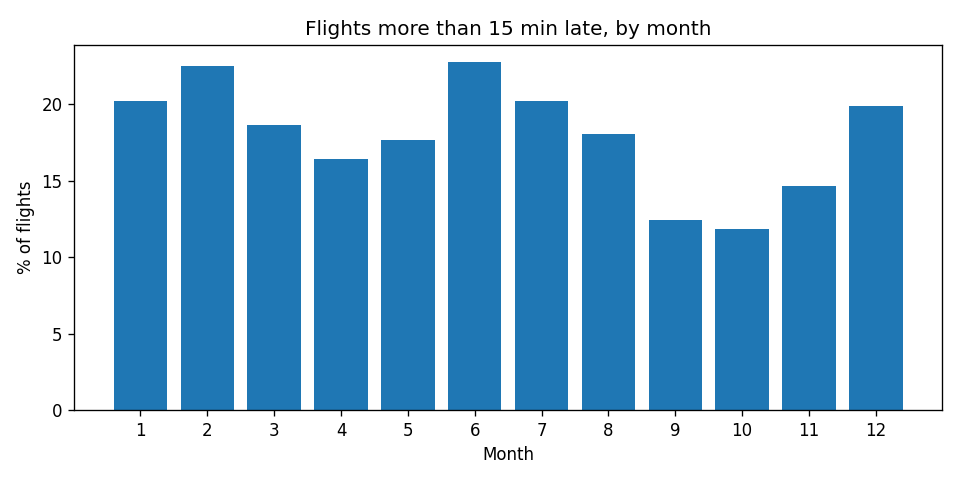

# Phase 1 Report — Data Audit

**Status:** ✅ Done · **Date:** 2026-11-27 · **Code:** `src/phase1_data_audit.py`

## Goal
Get to know the data and find its problems before any modeling. No data was changed in this phase; everything was measured on `flights.parquet` from Phase 0. The findings decide what Phases 2–4 have to fix, and the seasonal analysis in section 1.7 decides how the data is split in Phase 3.

---

## 1.1 — Data
`flights.parquet`: **5,819,079 rows × 31 columns**, one row per flight in 2015.

## 1.2 — Which columns can be used?
**Rule:** the model may only use information that is known **before the flight**. A website user asks for a prediction before flying, so anything learned during or after the flight cannot be an input. Using such a column is called **data leakage**: the model looks excellent in training but cannot work in practice.

| Group | Count | Columns |
|---|---|---|
| **Features** (known before the flight) | 9 | `AIRLINE`, `ORIGIN_AIRPORT`, `DESTINATION_AIRPORT`, `MONTH`, `DAY_OF_WEEK`, `SCHEDULED_DEPARTURE`, `SCHEDULED_ARRIVAL`, `SCHEDULED_TIME`, `DISTANCE` |
| **Target** | 1 | `ARRIVAL_DELAY` (minutes; negative = early) |
| **Known only after the flight** (never used as features) | 17 | `DEPARTURE_TIME`, `DEPARTURE_DELAY`, `TAXI_OUT`, `WHEELS_OFF`, `ELAPSED_TIME`, `AIR_TIME`, `WHEELS_ON`, `TAXI_IN`, `ARRIVAL_TIME`, `CANCELLED`, `CANCELLATION_REASON`, `DIVERTED`, `AIR_SYSTEM_DELAY`, `SECURITY_DELAY`, `AIRLINE_DELAY`, `LATE_AIRCRAFT_DELAY`, `WEATHER_DELAY` |
| **Other** (not used as features) | 4 | `YEAR` (always 2015), `DAY` (only to build the date), `FLIGHT_NUMBER`, `TAIL_NUMBER` (a website user would not know the aircraft) |

9 + 1 + 17 + 4 = 31: every column is accounted for. `CANCELLED` and `DIVERTED` are used only to filter rows.

## 1.3 — October airport codes
Airports are normally written as three-letter IATA codes (`ATL` = Atlanta). In this dataset October uses numeric BTS airport IDs instead (e.g. `14747`).

| Check | Result |
|---|---|
| Months with numeric origin codes | **October only** — 486,165 rows |
| Months with numeric destination codes | **October only** — 486,165 rows |
| All October rows | 486,165 → **every** October flight is affected, in both columns |
| Different numeric codes | **307** |

**Why it matters:** everything the model learns about `ATL` in other months would be useless for `10397` in October, and October flights will appear in train, validation and test. **Phase 2 maps the 307 codes to IATA codes.**

## 1.4 — Cancelled and diverted flights
| | Flights |
|---|---|
| Cancelled | 89,884 |
| Diverted | 15,187 |
| **Usable** (neither) | **5,714,008** |
| Missing `ARRIVAL_DELAY` in usable flights | 0 |
| Missing `ARRIVAL_DELAY` in removed flights | 105,071 of 105,071 |

Cancelled flights never arrived and diverted flights landed elsewhere, so they have no arrival delay. Every removed flight has an empty target and every usable flight has one, so removing them (about 1.8% of all flights) is the right choice. **Phase 3 removes them.**

## 1.5 — Missing values in the features
- In the 5,714,008 usable flights, **none of the 9 features has a missing value.**
- `SCHEDULED_TIME` has 6 missing values in the full data, but all of them are cancelled or diverted flights, so they disappear with the filter.

## 1.6 — Distribution of the delay (usable flights)
| Statistic | Minutes |
|---|---|
| Minimum | −87 |
| 5% / 25% | −25 / −13 |
| **Median** | **−5** |
| 75% / 95% / 99% | 8 / 66 / 167 |
| Maximum | 1,971 (≈ 33 hours) |
| **Mean** | **4.41** |
| Standard deviation | 39.3 |

| Share of flights | |
|---|---|
| Early (< 0 min) | 61.3% |
| More than 15 min late (official US "delayed") | **17.9%** |
| More than 3 hours late | 0.83% |

- Most flights arrive **early**; airlines build slack into their schedules.
- The distribution is **right-skewed**: a few very large delays pull the mean about 9 minutes above the median.

### One constant for every flight: median or mean?
| Constant prediction | MAE (all usable flights) |
|---|---|
| **Median (−5 min)** | **19.15 min** |
| Mean (+4.41 min) | 21.26 min |

MAE (mean absolute error) is smallest when the median is predicted. Linear Regression and RandomForest aim for the **mean** by default (they minimise squared error), so they start at a disadvantage when they are judged by MAE. This is why:
- the **baseline** of this project is "always predict the training median" (computed on the real split in Phase 3), and
- Phase 5 also trains LightGBM with an **absolute-error** objective, which aims for the median.

### Class balance for classification
Only **17.9%** of flights are more than 15 minutes late. A classifier that always says "not delayed" would already reach about 82% accuracy, so accuracy alone is misleading. **Phase 6 uses recall, precision, F1 and ROC-AUC as well.**

## 1.7 — Delay by month

| Month | Flights | Mean | Median | > 15 min late |
|---|---|---|---|---|
| 1 | 457,013 | 5.8 | −4 | 20.2% |
| 2 | 407,663 | 8.3 | −2 | 22.5% |
| 3 | 492,138 | 4.9 | −4 | 18.6% |
| 4 | 479,251 | 3.2 | −5 | 16.4% |
| 5 | 489,641 | 4.5 | −5 | 17.6% |
| 6 | 492,847 | **9.6** | −3 | **22.7%** |
| 7 | 514,384 | 6.4 | −4 | 20.2% |
| 8 | 503,956 | 4.6 | −5 | 18.0% |
| 9 | 462,153 | −0.8 | −7 | 12.4% |
| 10 | 482,878 | **−0.8** | −7 | **11.9%** |
| 11 | 462,367 | 1.1 | −6 | 14.6% |
| 12 | 469,717 | 6.1 | −5 | 19.9% |

- **Delays depend strongly on the season.** The share of delayed flights ranges from 11.9% (October) to 22.7% (June).
- Hardest months: **June** (summer storms, peak traffic), **February** (winter) and **December** (holidays, winter).
- Calmest period: **September–November**.

### Consequence for the split (decided in Phase 3)
A **month-based split** (e.g. train Jan–Aug, validation Sep–Oct, test Nov–Dec) would give very different parts:
- validation would be the calmest period of the year (≈12% delayed vs. 16–23% in training months);
- test would mix a calm month (November) and a hard month (December);
- the model would never see September–December in training, so `MONTH` could not be used.

Because the website will be used for flights in any month, the model should learn **all seasons**, and train, validation and test should be **comparable**. Phase 3 therefore splits **by day, stratified by month**: within every month, the days are randomly divided into train (70%), validation (15%) and test (15%), and all flights of a day stay in the same part (flights on the same day share the same weather, so splitting a day would leak information).

## 1.8 — Other checks
**Time columns (HHMM format, e.g. 1435 = 14:35):**

| Check | Result |
|---|---|
| `SCHEDULED_DEPARTURE` range | 1 – 2359 |
| `SCHEDULED_ARRIVAL` range | 1 – 2400 |
| Minutes part above 59 | 0 (both columns) ✅ |
| Value `2400` (midnight) | 1 row (arrival) |

HHMM cannot be given to a model as it is: 13:59 → 14:00 is 1 minute, but `1400 − 1359 = 41`. **Phase 4 converts both columns to minutes after midnight** (`2400` → 0).

**Airlines:** 13 of the 14 airlines fly in all 12 months. **US Airways (`US`) flies in only 6 months**: it merged with American Airlines in 2015. Its flights stay in the data, but the website should not offer it as an option.

---

## Summary: problems found and where they are handled
| Problem | Size | Handled in |
|---|---|---|
| Numeric airport codes in October | 486,165 flights, 307 codes | Phase 2 |
| Cancelled / diverted flights (no target) | 105,071 flights | Phase 3 |
| Columns known only after the flight | 17 columns | Never loaded as features (Phase 3) |
| Delays depend strongly on the month | 11.9% – 22.7% delayed | Phase 3: day-based split stratified by month |
| HHMM time format | 2 columns | Phase 4 |
| Mean ≠ median (right-skewed target) | 4.41 vs −5 min | Baseline = median; LightGBM with absolute-error objective (Phase 5) |
| Class imbalance for "> 15 min late" | 17.9% | Phase 6: metrics beyond accuracy |
| US Airways stops flying mid-year | 6 of 12 months | Website: not offered |

**Note:** this audit looked at the whole year before the data was split. Only aggregate statistics were used, and no decision here depends on individual flights that later end up in the test set.

## Outputs
| File | Location |
|---|---|
| `src/phase1_data_audit.py` | GitHub |
| `results/phase1_late_by_month.png` | GitHub (download from the Kaggle notebook output) |

## Next phase
**Phase 2 — October Airport Code Fix:** map the 307 numeric October codes to three-letter IATA codes without losing any row.
